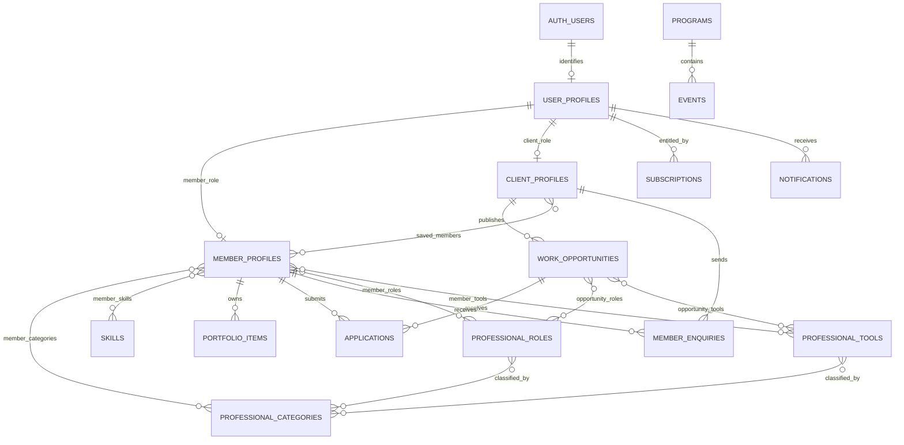

# Database design and migration guide

Supabase PostgreSQL is the source of truth for identities, roles, profile and workflow records. Cloudflare R2 stores binary files; PostgreSQL stores object keys and metadata. UUID keys and foreign keys connect the modules. Row Level Security and server-only RPC/route handlers enforce access.

## Migration order

1. `202611100001_create_user_profiles.sql` — account profile foundation.
2. `202611100002_ccb_platform_schema.sql` — role profiles, taxonomy, portfolio, discovery, opportunities, applications, programs/events, membership/service requests, content, subscriptions, reviews, notifications and audit schema/policies.
3. `202611100003_profile_image_references.sql` — media references on profile rows and media permissions.
4. `202611100004_admin_accounts.sql` — initial private Admin account table.
5. `202611100005_static_admin_credentials.sql` — converts the Admin table to manually provisioned `admin_id` plus `password_hash` credentials; inspect its script and provision Admin accounts with its bcrypt example.
6. `202611100006_platform_workflows.sql` — profile/trial provisioning, workflow RPCs, QR check-in and notifications, and safe discovery reads.
7. `202611100007_account_and_registration_workflows.sql` — controlled display-name changes and attendee registration cancellation with ticket revocation.
8. `202611100008_application_deadline_enforcement.sql` — checks closing timestamps and deadlines in the RLS application policy.
9. `202611100009_application_status_workflow.sql` — validates Member/Client application transitions and records participant-readable status history.
10. `202611100010_discovery_entitlement_rls.sql` — reserves saved/search history writes and Member enquiries for entitled Clients.
11. `202611100011_event_registration_rpc_only.sql` — removes direct inserts so all registrations pass the capacity/date/form-validation RPC.
12. `202611100012_portfolio_media_ownership_rls.sql` — restricts portfolio media and application attachments to the owning Member.
13. `202611100013_public_member_identity_rls.sql` — exposes only public Member identity to entitled Clients and engagement participants.
14. `202611100014_event_scanner_selected_event.sql` — binds atomic ticket check-in to the Admin-selected event.
15. `202611100015_public_content_featured_media.sql` — adds R2 media references for published Event and Program cover images.
16. `202611100016_external_event_rsvp.sql` — makes RSVP an Admin-managed external link; leaves old registration records intact and disables native registration/check-in RPCs.
17. `202611100017_central_professional_taxonomy.sql` — extends existing categories/skills with centrally seeded roles, tools, aliases, suggestion review, Member/opportunity links, work preferences, indexed search/rating functions, and ordered Event gallery media IDs.

Apply in order to a new project. If 001–005 are already installed, apply 006–017 in order after reviewing which have already been applied. Keep a backup and inspect migration state before running scripts. A migration file in this repository is not proof it has been applied to the hosted project. The user reports running the consolidated setup in Supabase; the hosted migration state has not been independently rechecked. Do not rerun the consolidated script after it has succeeded.

For the current Supabase schema shown in the screenshots (base tables present and `admin_accounts` already using `admin_id` / `password_hash`), `supabase/ccb-current-db-setup.sql` bundles migrations 003 and 005?017 into one transaction. It checks for the base tables before making changes and refuses to convert a populated legacy Admin roster. Run that bundle once against that base-schema state; do not also run the same individual migrations. It preserves legacy Event registration/form/ticket/attendance tables and their records while migration 016 disables native RSVP write paths.

After that setup has succeeded, run `supabase/ccb-opportunity-search-update.sql` once for migration 018. This is the incremental search update; it does not remove or recreate tables.

## Main relationships

## Authorization principles

- Admin credentials are separate from `user_profiles`; no public Admin signup exists. Password verification and Admin session signing happen only on the server.
- Member/Client ownership is tied to `auth.uid()` and a database profile. Never accept a client-supplied role or owner id without comparing it to the session.
- Member discovery is limited to public Member presentation fields; private profile media and other private fields must not become an accidental directory endpoint.
- Current Event RSVP is external: Admin stores an HTTPS URL, public pages link to it, and CCB does not accept native registrations or issue tickets. Legacy registration/ticket/attendance tables are retained for historical data but are not used by current Event flows.
- The 7-day trial is provisioned without inventing plan price. Entitlement gates are enforced in SQL and must be verified against the deployed RLS.

The exact column definitions and constraints are authoritative in the migration SQL. This document is an overview, not a substitute for reviewing that source before production.

## Table inventory and key fields

The source of truth is the `CREATE TABLE` and `ALTER TABLE` SQL in the migrations. The table below lists identity/ownership keys and the principal business fields; audit timestamps and individual constraints remain visible in SQL.

| Domain | Tables and key fields |
|---|---|
| Identity | `user_profiles(id → auth.users.id, account_type, display_name, avatar_url)`; separate `member_profiles(user_id, headline, bio, location, years_experience, availability, interests, visibility, media_id)` and `client_profiles(user_id, company_name, organization_type, industry, description, website, location, business contacts, verification, logo_media_id)`; `admin_accounts(admin_id, password_hash)` is separate. |
| Taxonomy/profile | Existing `professional_categories` and `skills` remain the canonical roots. Migration 017 adds stable-ID `professional_roles`, `professional_tools`, category join tables, `taxonomy_aliases`, and `taxonomy_suggestions`; Members link through `member_categories`, `member_skills`, `member_roles`, and `member_tools`. Opportunities target the same IDs through matching `opportunity_*` join tables. `member_work_preferences`, expected rate fields, and `get_personalized_opportunities` support relevance ranking. `portfolio_items`, media joins and social links remain as before. |
| Media/discovery | `media_assets(id, owner_user_id, bucket_name, object_key, filename, mime_type, file_size_bytes, visibility, alt_text)`; `saved_members(client_id, member_id)`; `client_search_history(id, client_id, search_filters, searched_at)`; `member_enquiries(id, client_id, member_id, subject, message, status)`. |
| Opportunities | `work_opportunities(id, client_id, title, description, budget, professionals_required, experience_min_years, location, work_arrangement, dates, status)`; join tables `opportunity_categories` and `opportunity_skills`; `applications(id, opportunity_id, member_id, cover_message, status, client_message, submitted_at, status_updated_at)`; `application_portfolio_items(application_id, portfolio_item_id)`; `application_status_history(id, application_id, actor_user_id, from_status, to_status, changed_at)`. |
| Programs/events | `programs(id, title, slug, description, dates, status)`, `program_enrollments(program_id, user_id, status)`; `events` retains its legacy fields and gains `event_category`, audience/visibility, deadline, `external_rsvp_url`, `rsvp_closed`, and announcement audience. Public registration points to an external RSVP form; old `event_form_fields`, registration, ticket and attendance records remain historical only. Media relationships are in `event_media` and `program_media`. |
| Intake/content | `membership_applications(id, user_id, applicant/contact fields, requested_category, status, admin_notes)`; `memberships(id, user_id, application_id, category, membership_number, status, dates, fee fields)`; `client_service_requests(id, client_id, type, subject, description, status, admin_notes)`; `partnership_enquiries(id, organisation/contact data, partnership_type, message, status)`; `articles(id, title, slug, content_type, body, featured_media_id, status, published_at)`; `recognition_awards` and `recognition_nominations` hold award windows and nominations. |
| Entitlements/trust | `subscription_plans(id, audience, name, billing_period, price, trial_days, active)`; `subscriptions(id, user_id, plan_id, status, trial/period dates)`; `subscription_entitlements(subscription_id, feature_key, enabled)`; `payments(id, subscription_id, user_id, gateway references, amount, status)`; `reviews(id, opportunity_id, reviewer_user_id, reviewed_user_id, rating, status)`; `notifications(id, user_id, type, title, message, read_at, delivery state)`; `audit_logs(id, actor_user_id, action, entity, details, created_at)`. |

## Constraints and indexing

The schema uses foreign keys/cascades to keep joins consistent; one Member/category and Member/skill relationship; one primary category per Member; unique event/user registration; unique ticket hash and ticket per registration; one attendance record per registration; one application per opportunity/Member; one review per reviewer/opportunity; and unique plan entitlement per subscription/feature. Range, enum-like status, visibility, capacity, rating and date checks live beside their columns.

The base migration indexes profile location/visibility; taxonomy reverse lookups; portfolio owner/order; media owner; opportunity owner/status, full text and application deadline; application participant/status; saved-member reverse lookup; program/event status/date; registrations; membership/service/partnership intake queues; subscription/payment/review/notification/audit lookups. Migration 009 indexes application status history by application and change time. Inspect query plans with production-like data before adding indexes or search infrastructure.

## Sensitive column guidance

Do not expose `admin_accounts.password_hash`, `event_tickets.token_hash`, subscription/payment provider references, Admin notes, email/phone/contact fields or social access tokens. Social access tokens are not currently stored. Client discovery is intended to expose presentation fields through RLS, not authentication email or private contacts. Never put an R2 secret or Supabase service key in database rows returned to the browser.

