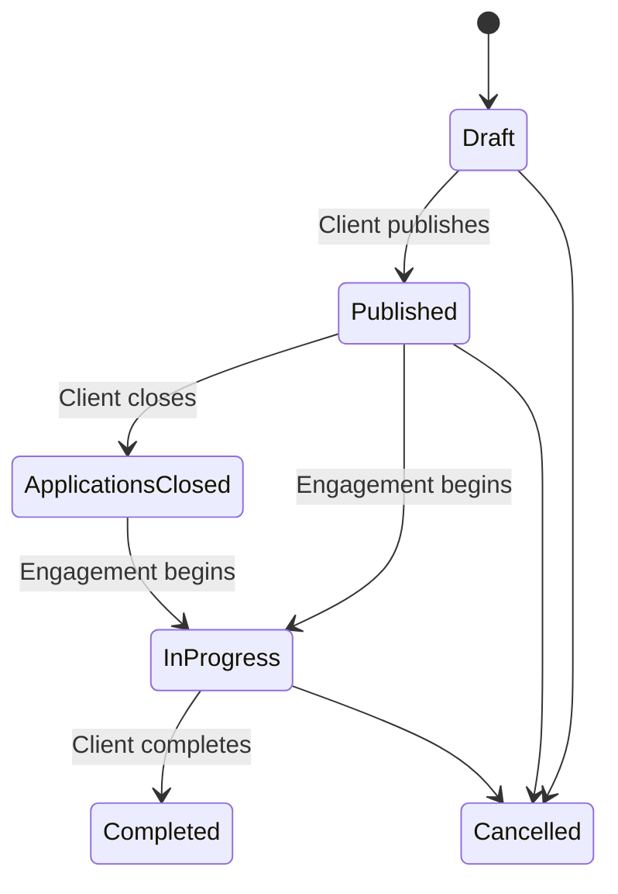
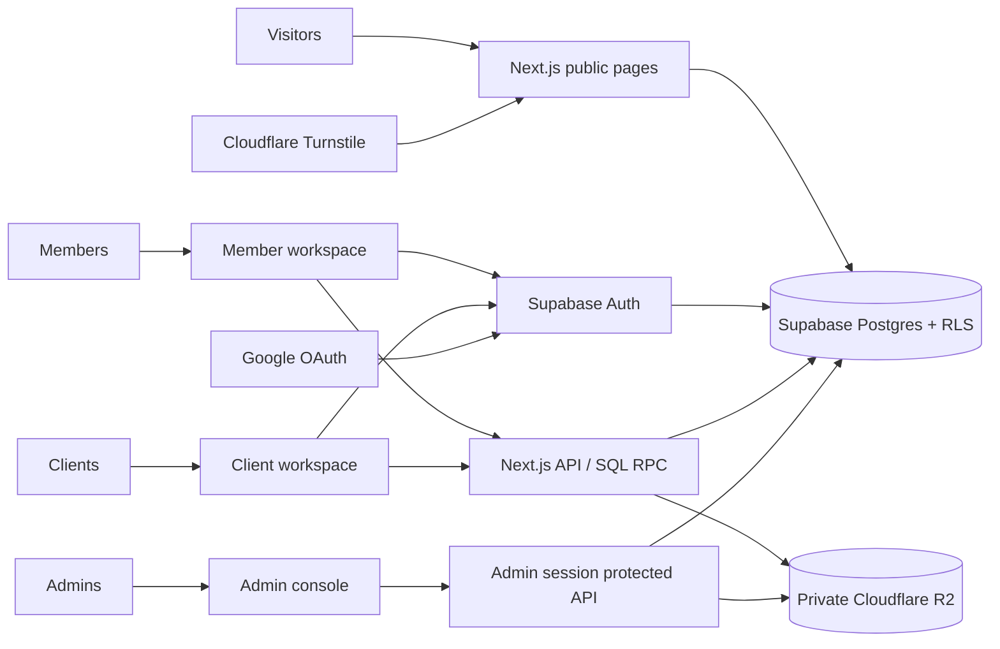
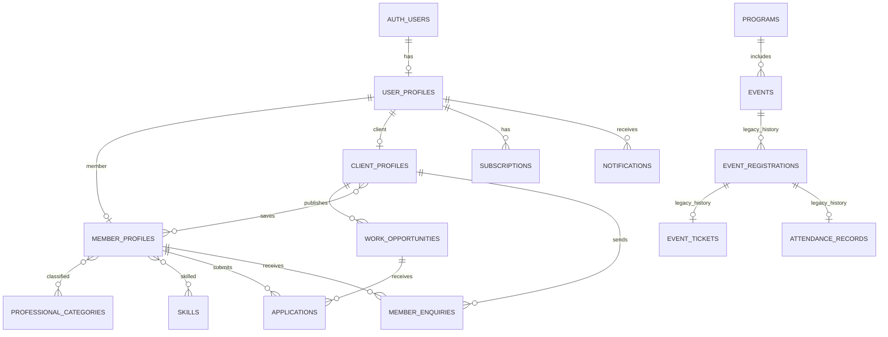

# CCB India — complete platform guide 

> This guide records the platform vision and the code that currently exists. It distinguishes running features from database scripts that still need applying, third-party settings, and unconfirmed CCB policy. Do not treat sample copy or a schema field as proof of an approved CCB business rule.

## 1. Project overview

CCB India (Chamber of Creators and Brands) is intended to connect individual creators and professionals with brands, businesses and organisations through a public site and three separate workspaces: Admin, Member / Influencer, and Client / Business. The initial architecture uses one Next.js application, one Supabase project, PostgreSQL with RLS, and private Cloudflare R2.

## 2. Vision and objectives

The platform aims to help professionals present their work, develop skills, find collaboration opportunities and engage with organisations. Clients should discover suitable talent, publish project opportunities and manage applications. CCB staff should manage approved platform content, users, programmes, events and intake workflows.

The application must protect personal data, enforce access on the server/database, avoid fictional institutional claims, and keep business rules such as pricing configurable until CCB confirms them.

## 3. Product scope

| Area | Current code | Remaining |
|---|---|---|
| Public website | Responsive content pages, published dynamic feeds/detail routes, application and partner enquiry forms | Approved organisational content/assets and legal/privacy copy |
| Member | Profile, taxonomy, portfolio links/images/video/PDF, social URLs, opportunities, applications, event/program activity, enquiries, membership history, notifications, subscription view | Long activity history pagination, full training-course delivery and Meta integration |
| Client | Organisation profile, directory, saved profiles, search history, enquiries, opportunities, applications, service requests, reviews, event/program activity, subscription view | Verification policy and contact rules |
| Admin | Separate ID/password console, CRUD catalogue, content and intake queues, private media library, external RSVP event management and taxonomy analytics | MFA, audit/retention policy, verified server key, production deployment |
| Services | Supabase Auth/RLS, SQL migrations, signed R2 media route, Turnstile gate | Apply the incremental migration 018 search update after the consolidated setup; verify the Supabase server key; payment/email/Meta providers remain deferred |

## 4. User types

- **Visitor:** reads published public content and submits public membership, partnership and recognition forms where enabled.
- **Member:** individual creator, influencer or digital professional. Uses Supabase email/password or Google Auth.
- **Client:** brand, company, agency or other organisation seeking professionals. Uses Supabase email/password or Google Auth.
- **Admin:** privately provisioned staff account. Uses a separate Admin ID/password login, bcrypt hash and seven-day signed HttpOnly session; there is no public Admin signup.

## 5. Core modules

Identity and role profiles; professional categories and skills; member portfolio and social links; client discovery, saved profiles and search history; opportunities and applications; programs and events; external Event RSVP links; membership applications; client service requests; public articles; recognition; media metadata; subscriptions/entitlements; reviews; notifications; audit logs.

## 6. Public website architecture

`app/page.tsx` renders the landing page and shared public shell. `app/[...slug]/page.tsx` allowlists known content routes and renders database detail pages; unknown paths return not found. `components/public/public-data.tsx` reads published events, programs and articles through Supabase policies. Public form submissions use their own tables and are distinct from authenticated platform workflows.

The Admin login link is in the landing page footer. Member and Client login are reached through the account selection flow. Admin does not share Member/Client session state.

## 7. Admin platform

Admin UI is in `zadmin/components/admin-console.tsx`; catalog definitions are in `zadmin/lib/catalog.ts`. The private API validates the Admin session before using a server Supabase client. It manages people, membership and service/partner intake, opportunities and applications, external RSVP events, programs, articles, taxonomy, recognition, media, plans/subscriptions/payments and audit entries. Events use external RSVP links; native event registration and check-in are disabled for current flows.

Admin password hashes are bcrypt values stored in `admin_accounts`. Migration 005 changes that table to `admin_id` and `password_hash`. Provision accounts only with its SQL example; never insert a plain-text password. A current live read-only probe found both expected columns and confirmed public access is denied.

## 8. Member platform

Member workspace at `/member/dashboard` supports account display name, professional headline, bio, location, experience, availability, contact preference, interests, profile visibility, categories, skills, portfolio website/items, social profile URLs and private profile photo. Members can browse published opportunities, apply, track application status, view client enquiries, open external Event RSVP links and enrol in programs, read notifications and inspect trial status.

Private Instagram metrics are not implemented. Social URLs are links only; profile sharing consent does not create an API connection.

## 9. Client platform

Client workspace at `/client/dashboard` supports account display name, organisation name/type/industry/description/location/contact/website/logo; directory discovery; saved Members; search history; Member enquiries; work opportunity drafts/publication/lifecycle; received applications and status updates; engagement reviews; separate CCB service requests; programs/events; notifications and trial view. Client verification state is Admin-managed schema data; publication requirements remain a decision.

## 10. User journeys

### Visitor to Member

1. Choose Member / Influencer at `/auth`.
2. Create an email/password or Google account after completing Turnstile.
3. Supabase role metadata/profile routes the user to `/member/dashboard`.
4. Add profile details, categories, skills, portfolio and social links; choose public visibility.
5. Discover opportunities, apply, track updates and attend published events.

### Visitor to Client

1. Choose Client / Business at `/auth`.
2. Create an email/password or Google account after completing Turnstile.
3. Complete organisation profile.
4. Discover and save visible Members, contact through the platform enquiry, and publish opportunities.
5. Review applications or separately submit a CCB service request.

### Admin

Admin rows are provisioned privately. The login route verifies Turnstile and checks credentials against the server database, then issues a seven-day HttpOnly cookie. Every Admin API revalidates the account/password hash so deletion or password change invalidates the session.

## 11. Authentication and authorization

Supabase Auth authenticates Member/Client identity. The database profile is authoritative for role; route guards redirect unauthenticated users. RLS scopes records to their owner/participants and publication status. Admin is a separate credential system. The browser never receives the Supabase secret/service-role key or R2 credentials.

Google provider is enabled in the connected project's Auth settings. Email provider is enabled and signup is not globally disabled. Production redirect URLs still must be added when the domain is chosen. Turnstile blocks the user auth form until a widget token exists; the Admin route verifies its token server-side.

## 12. Subscription and trial system

Migrations 006-015 provision trials/entitlements and enforce portfolio, application, discovery, and event-workflow rules; migration 016 adds external RSVP fields and disables current native ticket workflows; migration 017 adds the supplied central taxonomy, indexes, role/tool targeting, suggestions, and rule-based opportunity matching; migration 018 adds server-side keyword and filter search for Member opportunities. SQL `has_entitlement` checks entitlement/time state. Profiles remain accessible if a paid provider is absent. This is not an implemented paid billing system and entitlement behaviour must be exercised after migrations are applied.

## 13. Payment architecture

Schema tables and Admin views exist for plans, subscriptions and payment records. No payment gateway is connected; do not create browser-side payment success records. A future provider must create orders server-side, verify signatures/webhooks, update records idempotently, and define failure, refund, cancellation and renewal handling.

## 14. Work opportunity lifecycle

Clients create drafts and target the shared category, role, skill and tool IDs. Members receive a rule-ranked feed, filter published opportunities, and apply. The owning Client reviews their applicants; Members may withdraw. Application statuses are submitted, under review, shortlisted, selected, rejected and withdrawn. Migration 009 validates permitted transitions in the database and records a participant-readable status timeline. Opportunity statuses are draft, published, applications closed, in progress, completed and cancelled.

## 15. Member discovery and search

Client search uses public profiles, headline/bio, location, category, role/service, skill, tool/software, experience, availability, expected rate and published-rating filters. Keyword search resolves the same central taxonomy and recognized aliases through indexed PostgreSQL full-text search. Results are database-paginated with exact counts; filters are stored in `client_search_history`. Saved profiles are stored separately. Social analytics require an approved Meta integration and Member sharing consent. Member opportunities use an entitlement-checked ranked PostgreSQL feed with database pagination, indexed full-text title/description search, taxonomy/alias search, and server-side location, target and budget filters (migration 018). Private contacts and media remain protected.

## 16. Central professional taxonomy

Existing `professional_categories` and `skills` remain the canonical roots. Migration 017 adds stable-ID professional roles, tools/software, category associations, aliases, suggestion review, Member/opportunity join tables, and the supplied starter catalogue. Profiles, opportunity targeting, discovery, Admin maintenance, and the rule-based opportunity feed reuse those IDs. Admin can add or deactivate approved options; users submit suggestions for review. PostgreSQL search uses full-text indexes across approved entries and aliases. ML recommendations are deferred.

## 17. Programs and initiatives

Programs are ongoing initiatives and are separate records from dated events. Admin can publish program content; signed-in users can enrol and view their enrollment. This supports listing and enrollment for CCB programs. Full online training courses and learning materials are marked as coming soon; lessons, course sessions, completion tracking and certificates are not part of the current phase. Program announcements and assets should only show when published.

## 18. Events management

Admin manages event content, event category, audience, visibility, date/time, venue/online details, registration deadline, external HTTPS RSVP URL, RSVP closure, announcement audience, and an R2-hosted image/video gallery. Public pages show published public events. Event announcements create in-app notifications for the selected Member/Client audience; outbound email is not connected because no application mail sender is configured.

## 19. External Event RSVP

Events use an Admin-managed HTTPS RSVP URL such as Google Forms. CCB displays published public event details and redirects users through Register / RSVP. Current flows do not collect responses, create native registrations, issue QR tickets, approve registrations or track attendance. Registration closed is shown on public events; Admin can distinguish Published, Completed and Cancelled event states. Legacy registration, ticket and attendance tables remain for historical records only.

## 20. Legacy event data

The former native registration, QR ticket and attendance tables are preserved so historical records are not deleted. Current Admin and user flows do not create registrations, generate tickets, approve attendees or check attendance; migration 016 revokes the native registration/ticket/check-in RPCs.

## 21. News and knowledge management

Admin article records support news, insight, research, report and announcement content with draft/published/archived status and optional featured media. Public views read published articles. Approved institutional information and user-supplied media are needed before launch.

## 23. Membership applications

Public membership intake is stored in `membership_applications`, separate from platform account registration and work opportunity applications. Signed-in applicants can see their own submissions in the Member dashboard after migration 007; Admin can review status and internal notes. Membership categories, eligibility, approval policy and fees are not confirmed.

## 24. Client service requests

A Client's request to CCB is stored in `client_service_requests`, separate from a Client's opportunity and the Member's application to that opportunity. Clients can view their own submissions and Admin can update status/notes.

## 25. Reviews and ratings

Review schema and UI support participant ratings for a completed opportunity. Database policies check participant and completion state and constrain duplicate reviews; Admin can moderate pending/published/hidden/rejected reviews. A public aggregate rating display and moderation/appeals process require more work and policy.

## 26. Instagram integration

Only Member-entered social URLs exist. Private metrics require creator-authorized official Meta OAuth, eligible account, approved permissions/app review, encrypted server-side tokens, limited sync, timestamps and explicit sharing. No username/API-key shortcut should be treated as private analytics access.

## 27. Notification architecture

Database triggers create in-app notices for application, registration, service-request and membership status changes; Members/Clients can mark their own notices read. Notifications are not sent by email/SMS. Delivery provider, templates, preferences, retries and retention remain to be selected.

## 28. System architecture

The running backend is Next.js route handlers plus database RPCs. A separate Cloudflare Worker deployment has not been configured. When moving to Workers, carry over session verification, RLS, ownership checks, ticket validation and rate limits; do not create a public R2 bucket to simplify delivery.

## 29. Technology stack

| Concern | Current choice |
|---|---|
| Web | Next.js 16 App Router, React 19, TypeScript |
| Auth/data | Supabase Auth, PostgreSQL, PostgREST, RLS, SQL functions |
| Files | Private Cloudflare R2 via S3-compatible signed requests |
| Bot protection | Cloudflare Turnstile |
| Styling | CSS plus Tailwind CSS 4 toolchain and UI utilities |
| Icons | lucide-react |
| Package manager | pnpm 12 declared; only `pnpm-lock.yaml` is committed |

## 30. Cloud infrastructure

Supabase Auth/database and Cloudflare R2/Turnstile are configured in the local environment. Cloudflare Pages/Workers, domain, production callback URLs, DNS, monitoring/backups and CI/CD are not configured. Supabase database and R2 storage quotas are separate; check current provider limits and usage before launch rather than assuming a free tier scales indefinitely.

## 31. Database architecture

Apply numbered migrations in timestamp order. PostgreSQL stores structured records, permissions, text and media metadata. R2 stores file bytes. See [DATABASE-DESIGN.md](DATABASE-DESIGN.md) for relationships and security model. A migration file in the repository is not evidence it has been run in Supabase.

## 32. Entity relationships

## 33. Backend API architecture

Authenticated browser clients use Supabase under RLS for owner-scoped CRUD. Sensitive actions use narrowly scoped SQL RPCs, including entitlement-gated opportunity lifecycle and alias-aware directory search. Events use external RSVP links; legacy ticket RPCs are revoked for current flows. Next route handlers cover private media upload/read and Admin operations. Inputs are validated at the boundary, and account role/ownership are derived from verified sessions.

## 34. Media storage strategy

R2 stores profile photos, client logos, portfolio images/video/PDF and editorial/Event/Program cover images; Postgres `media_assets` stores owner, bucket, object key, MIME type, size, visibility and alt text. The bucket must remain private. Member/Client profile images are limited to image formats and 10 MB; Member portfolio files have type-specific limits and signature checks. A short-lived signed PUT is scoped to the caller's object prefix; completion verifies object size/type; signed GET is issued only after RLS permits the metadata row. Admin uses separate endpoints. To attach public media, upload it in the Admin Media library, set its visibility to public, copy its Media ID, and attach it as a featured image or through the Event gallery media list. The Admin library accepts images up to 10 MB and MP4/WebM/QuickTime videos up to 150 MB. The object remains private in R2 and is delivered through `/api/media` after its public metadata policy allows access.

## 35. Security and privacy

Never commit `.env.local`. `NEXT_PUBLIC_` keys are browser visible and must only be project URL/public anon or publishable key. Supabase secret/service-role key, R2 credentials, Turnstile secret and Admin session secret are server-only. Enforce RLS and ownership checks, validate upload content metadata, keep media private, rotate secrets if exposed, use HTTPS/cookie protections in production, audit sensitive Admin actions and define data retention/export/deletion before launch. Admin MFA is not implemented.

## 36. Role and permission matrix

| Capability | Visitor | Member | Client | Admin |
|---|---:|---:|---:|---:|
| Read published public site/content | Yes | Yes | Yes | Yes |
| Manage Member profile/portfolio | No | Own account | No | Admin tools |
| Manage organisation profile | No | No | Own account | Admin tools |
| Browse opportunities/apply | No | Entitled account | No | Oversight |
| Discover/save Members | No | No | Entitled account | Oversight |
| Publish/manage opportunity | No | No | Own opportunity | Moderation |
| Review opportunity applicants | No | No | Own opportunity | Oversight |
| Submit CCB membership/partner intake | Public form | Own history if linked | As applicable | Review |
| Event RSVP | Public event page and external RSVP redirect | No native RSVP data | No native RSVP data | Manage external URL and status |
| Manage platform catalog/content | No | No | No | Yes |

Every control remains subject to database/server authorization. The table describes intended behavior; deployed RLS must be tested per role.

## 37. Responsive design

Public pages and dashboards use responsive CSS. Dashboard navigation uses a compact layout on small screens; Admin console includes mobile rules. Verify actual target devices, keyboard navigation, reduced motion, contrast, camera permissions and file input behavior before launch.

## 38. Performance and scalability

Queries use indexes and bounded limits. Admin lists, Client discovery and Member opportunity feeds use server-side pages; Member opportunity keyword and taxonomy searches run in PostgreSQL; long personal activity lists remain bounded and need page navigation before records grow. Avoid loading the whole Member directory. Use optimized image delivery, background processing for outbound notifications, measured caching and database/R2 usage monitoring. Do not add a separate search engine or microservices before measured need.

## 39. Environment configuration

Copy `.env.example` to `.env.local`. Supported alternatives are `NEXT_PUBLIC_SUPABASE_PUBLISHABLE_KEY` or `NEXT_PUBLIC_SUPABASE_ANON_KEY`, and `SUPABASE_SECRET_KEY` or legacy `SUPABASE_SERVICE_ROLE_KEY`.

| Variable | Purpose | Exposure |
|---|---|---|
| `NEXT_PUBLIC_SUPABASE_URL` | Supabase project URL | Browser |
| `NEXT_PUBLIC_SUPABASE_PUBLISHABLE_KEY` or `NEXT_PUBLIC_SUPABASE_ANON_KEY` | Public client key | Browser |
| `SUPABASE_SECRET_KEY` or `SUPABASE_SERVICE_ROLE_KEY` | Privileged server database access | Server only |
| `ZADMIN_SESSION_SECRET` | Signs seven-day Admin session; at least 32 random characters | Server only |
| `NEXT_PUBLIC_TURNSTILE_SITE_KEY` | Turnstile widget | Browser |
| `TURNSTILE_SECRET_KEY` | Turnstile server verification | Server only |
| `R2_ACCOUNT_ID`, `R2_ACCESS_KEY_ID`, `R2_SECRET_ACCESS_KEY`, `R2_BUCKET_NAME` | Private signed R2 requests | Server only |

### Supabase and Cloudflare setup state

Apply migrations 001-017 in timestamp order to a new project. Existing projects must first check applied migration state and run only missing migrations. The connected project was previously confirmed to have base schema/Admin ID/password columns and lack `application_status_history`; migration 009 was therefore not installed at that check. Do not rerun already-applied migrations.

Read-only connection checks confirmed Supabase email and Google providers are enabled, public content tables are reachable, and R2 signed requests reach the private bucket. The current server key returned HTTP 401, so replace `SUPABASE_SECRET_KEY` with a current key from this same project before Admin login, privileged APIs or SQL-backed workflows can be considered connected. A deliberately invalid Turnstile token was rejected as expected. Never expose the replacement key.

For local OAuth, allow `http://localhost:3000/auth/callback` in Supabase and set the Supabase Auth callback URL in the Google OAuth client. Configure Turnstile to allow localhost. Configure the private R2 bucket CORS for the application origin, `PUT`, and `Content-Type`; do not enable public bucket access. Create Admin accounts using the bcrypt SQL example in migration 005.

## 40. Local development setup

Prerequisite: compatible Node.js and dependencies installed with the pnpm lockfile. In PowerShell run `npm.cmd run dev`, then open `http://localhost:3000`. `pnpm` is declared but may not be on PATH. Use `corepack pnpm install` if dependencies need installing. Supabase must allow `http://localhost:3000/auth/callback`. The Cloudflare Turnstile widget must allow the local host.

## 41. Deployment architecture

Production target is not selected. Next route handlers require a compatible server runtime; verify Cloudflare's current Next.js Workers adapter/runtime support before choosing Pages or Workers. Set production env secrets, R2 CORS, exact Google/Supabase redirects and Turnstile hostnames after domain selection. A standalone Worker for file access is not currently deployed.

## 42. Testing strategy

The local TypeScript check and optimized production build pass after source changes. Earlier local smoke checks confirmed public/auth/Admin login routes return 200 and signed-out Member/Client dashboards redirect to authentication. Prior live checks confirmed Supabase Auth settings and public content access; they do not prove successful account authentication, RLS isolation, the new migrations, Admin login, event notification delivery, or R2 upload/download.

Before launch, exercise each workflow using separate visitor, Member, Client and Admin accounts; test denied cross-account reads, external RSVP visibility and closure, upload MIME/size/ownership, and mobile/keyboard/camera behavior.

## 43. Error handling and logging

User workflows display operation errors and in-app status notices. Sensitive Admin actions write audit rows. Avoid logging credentials, ticket secrets, full private messages, payment details or signed URLs. Production should add structured server monitoring, alerting, retention and redaction policy.

## 44. Backup and recovery

Use Supabase's configured backup/export capabilities and periodically verify restore procedures. R2 objects and the Postgres metadata must be backed up/reconciled separately. Keep versioned SQL migrations and tested recovery instructions. Provider backup availability and retention depend on the selected account plan.

## 45. Development roadmap

1. **Foundation:** apply migrations, correct server key, verify RLS and role onboarding.
2. **Public site:** replace placeholder images/copy with approved CCB assets and final public content.
3. **Profiles:** verify portfolio file attachments, account display-name editing and profile visibility on the deployed database.
4. **Discovery:** validate availability, experience, category/role/skill/tool, rate, rating, budget and work arrangement filters; finish pagination for long personal activity lists.
5. **Opportunity lifecycle:** test draft/publish, applications, status and participant review permissions.
6. **Admin operations:** exercise content, intake, registration, audit and taxonomy workflows using a valid server key.
7. **Events:** validate external RSVP URL, visibility, closure and event lifecycle; preserve legacy registration history.
8. **Business services:** choose email and payment providers, then implement secure callbacks/webhooks.
9. **Optional social:** obtain Meta product approvals before implementing insight sync.
10. **Production:** decide host/domain, migrate route handlers appropriately, test privacy/security, backups, monitoring and responsive UX.

See [DEVELOPMENT-ROADMAP.md](DEVELOPMENT-ROADMAP.md) for acceptance criteria.

## 46. Implementation priorities

Immediate: configure a valid Supabase privileged key, verify the consolidated database setup and apply migration 018 for Member opportunity search, provision Admin rows, then smoke-test Member/Client/Admin accounts. Next: validate RLS isolation and the external RSVP event workflow. Then finish selected payment/email/social/deployment integrations.

## 47. Known limitations

- The user reports running `supabase/ccb-current-db-setup.sql`; the hosted schema has not been independently rechecked. Run `supabase/ccb-opportunity-search-update.sql` once to enable migration 018 search. Do not rerun the consolidated setup if it succeeded.
- The configured Supabase server key returned HTTP 401 in a read-only REST/Admin Auth probe; Admin and privileged route operations cannot be considered live until a valid key from this same Supabase project is configured.
- Member/Client role pages compile and render, but live sign-in and RLS workflows have not been exercised with test accounts.
- Profile, logo and portfolio image/video/PDF uploads use private R2 signed URLs; validate these with the configured server key and R2 bucket before launch.
- Admin lists and Client discovery have server-side pagination; Long personal activity lists still use bounded result caps.
- No payment processor, email/SMS delivery, Meta OAuth, production Cloudflare deployment, domain, account export/deletion or Admin MFA is connected.
- Membership fees/categories and CCB-approved institutional copy/assets remain unconfirmed.

## 48. Pending product decisions

See [PENDING-DECISIONS.md](PENDING-DECISIONS.md). Decisions include pricing, billing and refunds; payment gateway; email provider; membership categories/eligibility; Member-to-Client contact rules; client verification and moderation; Meta access/sharing; retention/MFA; hosting/domain; and approved CCB content.

## 49. Future enhancements

Portfolio media galleries and video delivery, enhanced search/pagination, invitations and automatic waitlist promotion, notification preferences and delivery, verified Client workflows, subscription billing, public review aggregates, official Meta metrics, data export/deletion, Admin MFA, production monitoring and deployment automation.

## 50. Glossary

- **Member:** individual creator or professional using the Member workspace.
- **Client:** organisation using the Client workspace to discover and engage Members.
- **Opportunity:** Client-authored professional collaboration/project listing.
- **Application:** Member response to a Client opportunity.
- **Service request:** Client request directed to CCB itself, separate from opportunities.
- **Membership application:** request for CCB organisational membership, separate from platform signup.
- **Program:** ongoing initiative which may contain multiple Events.
- **Event registration:** attendee record for a specific Event.
- **Entitlement:** backend permission derived from account/trial/subscription state.
- **RLS:** PostgreSQL Row Level Security policies that scope database access.
- **R2 object key:** private bucket path for binary media; not a public URL.

## Related documentation

- [System architecture](SYSTEM-ARCHITECTURE.md)
- [Database design](DATABASE-DESIGN.md)
- [Development roadmap](DEVELOPMENT-ROADMAP.md)
- [Pending decisions](PENDING-DECISIONS.md)
- [Asset mapping](ASSET-MAPPING.md)

## Current Event RSVP scope

Events use an Admin-managed HTTPS RSVP URL (for example, Google Forms). CCB displays published public event details and redirects through the Register / RSVP link; it does not collect responses, create new registration rows, issue QR tickets, approve registrations, or track attendance. Registration closed, completed, and cancelled states are displayed. Legacy event registration/ticket/attendance tables are retained as historical data only.
