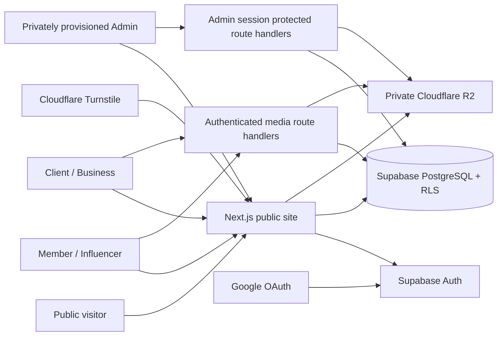
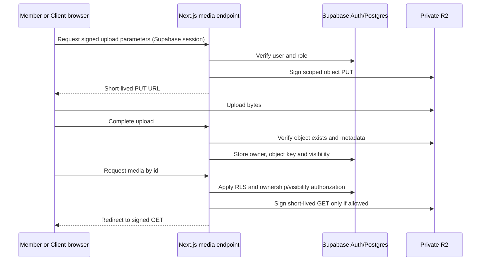
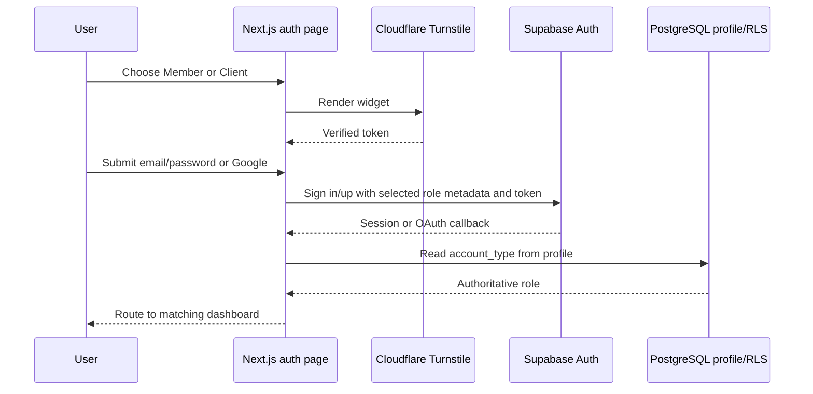
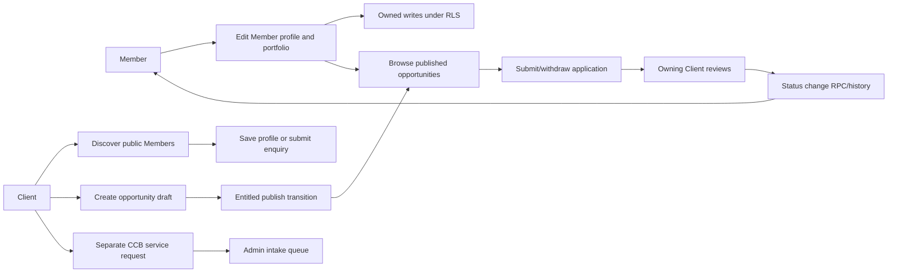
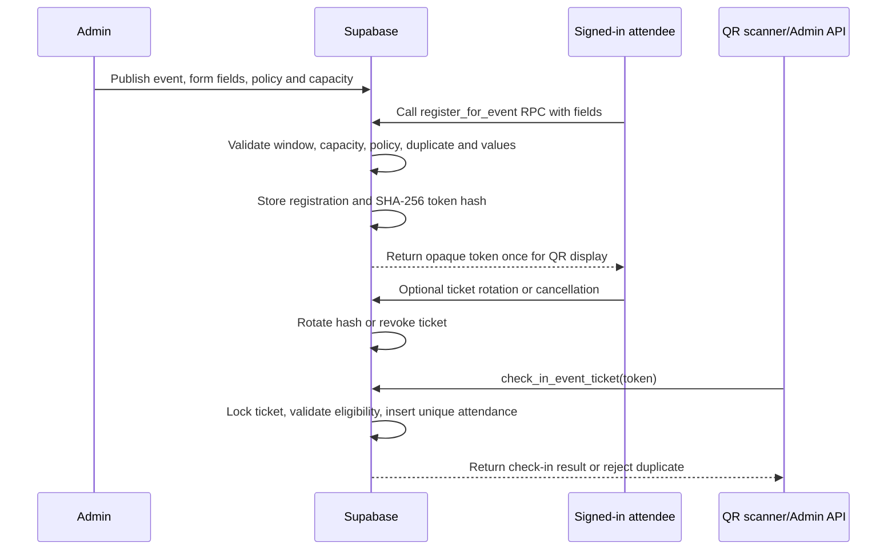
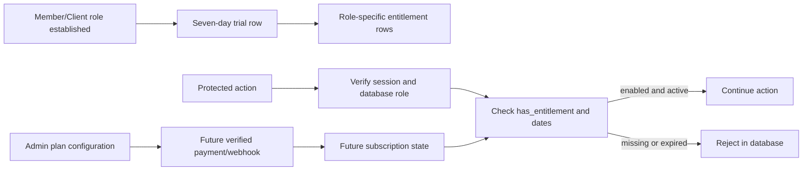

# System architecture

## Current topology

The public pages, Member workspace, Client workspace, and Admin console share a Next.js app and Supabase project but have separate route groups and authorization. Member and Client authenticate with Supabase Auth. Admin uses a separate manually provisioned ID/password table and a signed seven-day HttpOnly cookie. The Admin session is not a Supabase end-user session.

## Private media flow

Objects remain private. R2 credentials and Supabase service credentials run server-side only. Admin media routes use the separate Admin session. Worker deployment is not active; Next.js route handlers implement the current backend boundary. If production hosting requires Workers, preserve these authorization checks when adapting the handlers.

## Trust boundaries

- Supabase Auth proves the identity of Member and Client sessions; database role/profile and RLS govern data access.
- Admin identity is independently checked against `admin_accounts`; password hashes are bcrypt and sessions are signed with `ZADMIN_SESSION_SECRET`.
- Public content is read only when published. Public-member discovery excludes private contact data and depends on profile visibility and Client entitlement.
- Ticket tokens are random opaque values; only SHA-256 hashes are persisted. Ticket verification and check-in are backend operations, and attendance is atomic.
- RLS is not replaced by hiding interface controls. Migrations 0006–0011 add explicit workflow functions and safe-profile policies; review the policies on the target Supabase project before production.

## External services not connected

Payments, outbound email/SMS, official Meta/Instagram data access, Cloudflare deployment, domain and production callback URLs remain pending. Do not substitute browser-side secrets or trust a payment success redirect.

## Authentication and role routing

The chosen role guides signup, but the database profile decides access. OAuth callback does not grant Admin role. Admin login uses a separate endpoint/table/cookie and is not part of this sequence.

## Member and Client data flows

## Event and ticket flow

## Entitlement flow

No paid provider is wired; the lower payment path is future architecture, not an active checkout.

## Component boundaries and operations

- **Public UI:** renders approved static content plus published database listings; anonymous RLS grants do not include private identity or workflow records.
- **Member/Client UI:** presents role-specific actions and reads/writes through session-bound Supabase clients under RLS; high-risk lifecycle changes use RPCs.
- **Admin UI:** sends resource operations to `/api/zadmin/*`; endpoints revalidate the distinct Admin session, then use the server-only Supabase key. Do not infer Admin authorization from a browser role.
- **Media API:** `/api/media` creates caller-scoped R2 PUT signatures, verifies size/type and file signature at completion, stores metadata through the caller's Supabase session, and returns a short-lived read only after RLS allows the media row.
- **Event check-in API:** requires Admin cookie and sends token to a service-only RPC; the token hash is compared atomically in Postgres.
- **Infrastructure:** Cloudflare R2 and Turnstile are configured; production Next hosting, Worker adapter, custom domain, monitoring and CI/CD are not.

